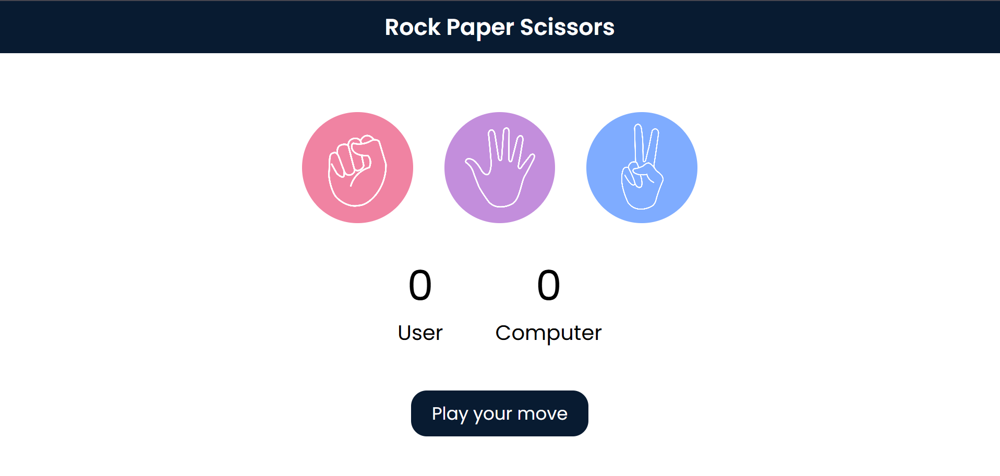

# 🎮 Rock Paper Scissors Game


A fun, fast, and interactive browser-based version of the classic Rock–Paper–Scissors game built using HTML, CSS, and JavaScript.

Play against the computer, track your score, and enjoy a clean, responsive UI with smooth animations.

---

## 📸 Screenshots



---

## 🌐 Live Demo

The project is live and can be played here: [Rock Paper Scissors Game](https://tonystark-19.github.io/Rock-paper-scissors/)

---

## ✨ Features

| Feature | Description |
|:---|:---|
| **Play vs Computer** | Challenge a computer-controlled opponent in a quick and engaging game. |
| **Fully Responsive Design** | Provides a seamless gaming experience across desktops, tablets, and smartphones. |
| **Score Tracking** | Maintains a running tally of player and computer scores throughout multiple rounds. |
| **Instant Results** | Automatically detects and displays whether the player wins, loses, or ties after each round. |
| **Smooth Animations** | Enhances the gaming experience with simple animations and smooth visual transitions. |
| **Replay Anytime** | Allows players to start unlimited rounds and enjoy continuous gameplay. |

---

## 🧠 Game Rules

| Rule | Outcome |
|:---|:---|
| **Rock vs Scissors** | Rock wins. |
| **Scissors vs Paper** | Scissors wins. |
| **Paper vs Rock** | Paper wins. |
| **Same Choice** | The round ends in a tie. |

---

## 🛠️ Technologies Used

| Technology | Purpose |
|:---|:---|
| **HTML5** | Structures the game's content and layout. |
| **CSS3** | Handles game styling, animations, and responsive design. |
| **JavaScript** | Implements game logic, computer opponent functionality, score tracking, and player interactions. |

---

## 🎮 How to Play

1. Visit the Game [here](https://tonystark-19.github.io/Rock-paper-scissors/).
2. Choose one of the options: **Rock**, **Paper**, or **Scissors**.
3. The computer will randomly choose one as well.
4. The result of the match will be displayed:

   - **Rock beats Scissors**  
   - **Scissors beat Paper**  
   - **Paper beats Rock**
     
6. The score is updated after each round.
7. Play as many rounds as you'd like.

---

## 🛠️ How to run on your own system

1. Clone the repository:

   ```bash
   git clone https://github.com/TonyStark-19/Rock-paper-scissors.git
   ```

2. Navigate into the project folder:

   ```bash
   cd Rock-paper-scissors
   ```

3. Open `index.html` in your browser.

---

## ⭐ Support

If you enjoyed this project, please consider giving it a ⭐ star on GitHub. <br />
Feedback and suggestions are always welcome!

---

Made with ❤️ by Aditya chandel